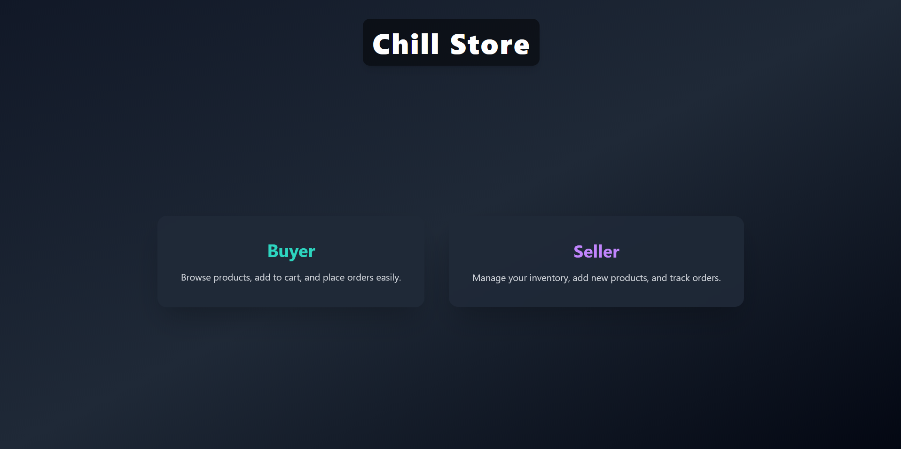
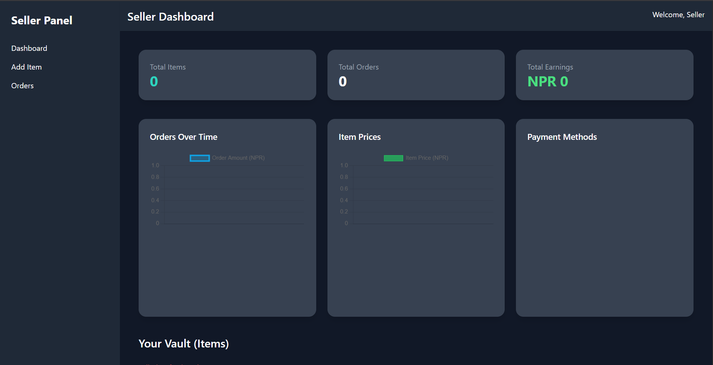
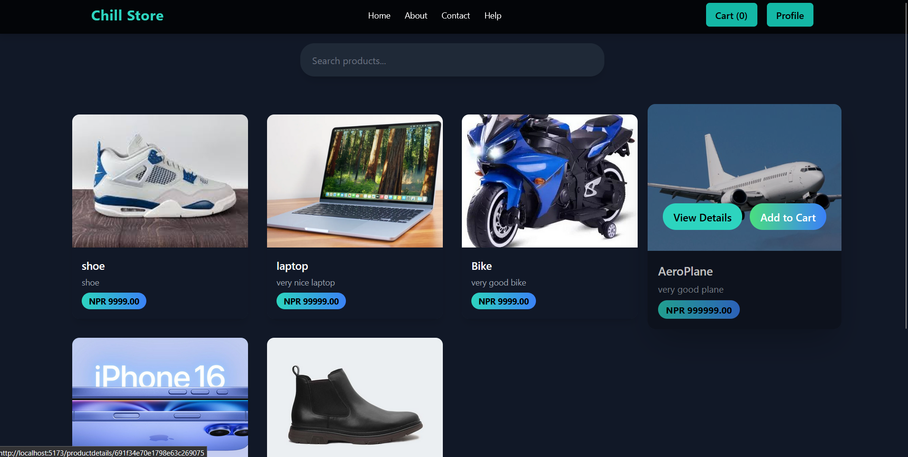
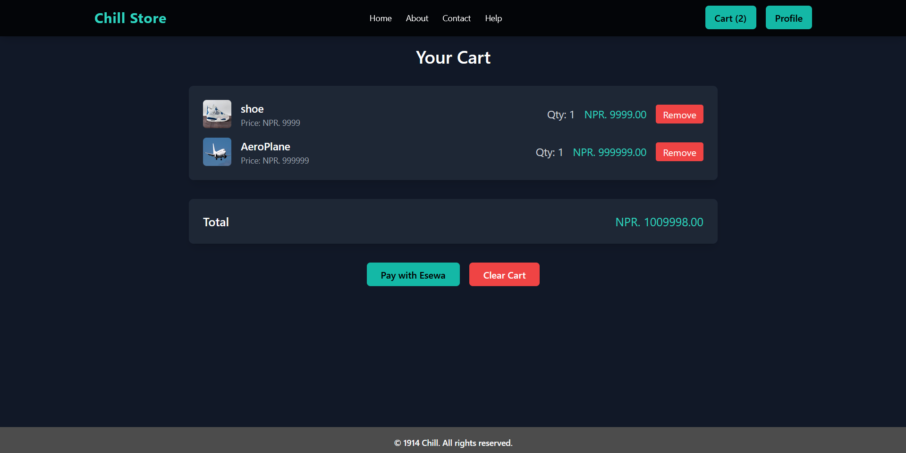
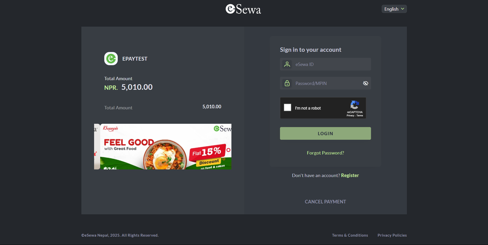
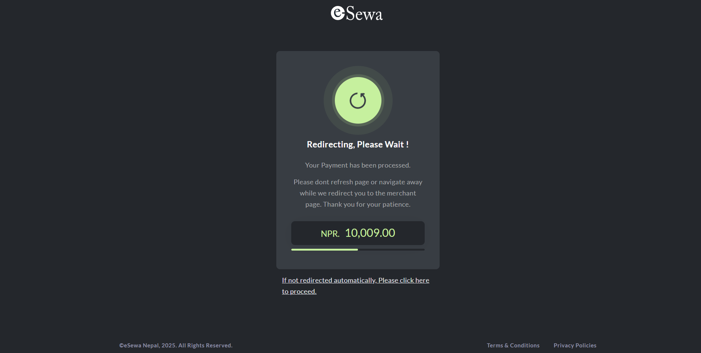
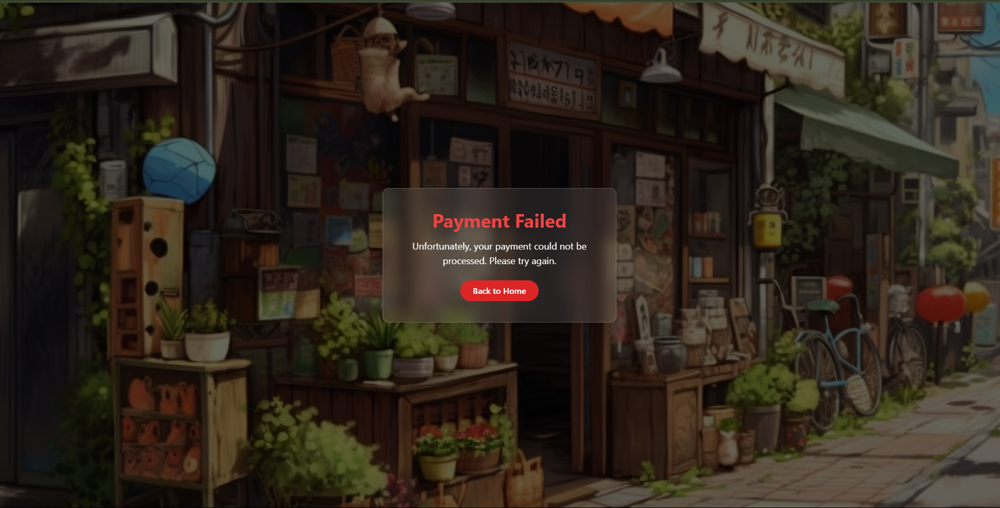
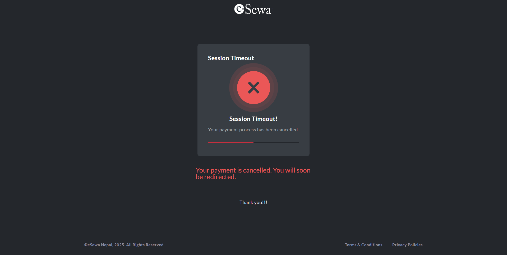
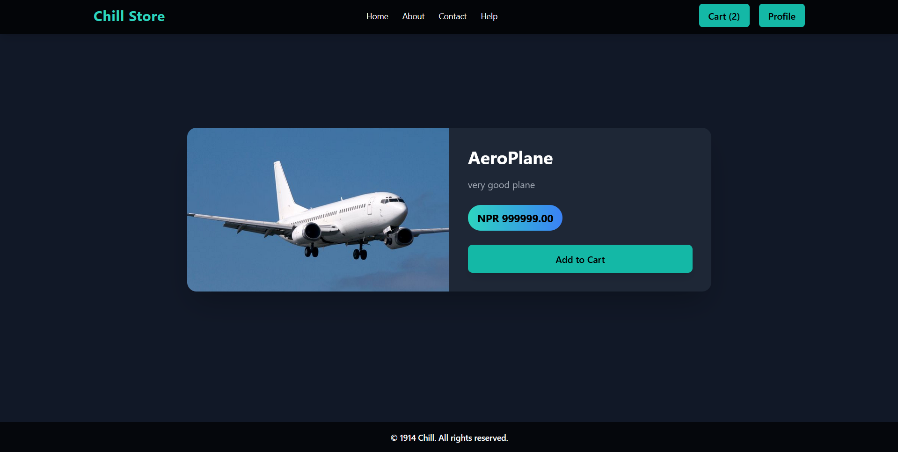

# 🌟 Chill-Store — Modern E-Commerce Platform

Chill-Store is a sleek and responsive **full-stack e-commerce application** designed to provide a smooth shopping experience to users and an intuitive dashboard for sellers.  
It includes product listings, image uploads, order handling, and secure payments via **eSewa**.

---

## 🔧 Tech Stack

### **Frontend**
- ⚛️ React.js  
- 🎨 Tailwind CSS  
- 🔄 Recoil  
- ⚡ Vite  

### **Backend**
- 🟢 Node.js  
- 🚂 Express.js  
- 🗄️ MongoDB + Mongoose  
- 🖼️ Multer (Image Upload)  

### **Payments**
- 💸 eSewa Payment Gateway  

---

## 📸 Screenshots

### 🏠 1. Landing Page  


### 📊 3. Seller Dashboard  


### 🏬 4. Home Page  


### 👤 5. Profile Page  


### 🛒 6. Cart Page  


### 💳 7. eSewa Payment  


### ✅ 8. Payment Success  


### 🔁 9. Redirecting After Success  


### ❌ 10. Payment Failure  


### 🔁 11. Redirecting After Failure  


### 🛍️ 12. Product Details  


---

## 🚀 Features

### 🛍️ **User Features**
- Product browsing & filtering  
- Add to cart & checkout  
- eSewa online payment  
- Order status tracking  
- Responsive UI  
- Profile management  

### 🧑‍💼 **Seller Features**
- Add, edit & remove products  
- Product image upload via Multer  
- Seller dashboard with charts  
- View & manage orders  
- Earnings visualization  

---

## 📦 Installation & Setup


### 1️⃣ Clone the repository
```bash
git clone https://github.com/viperofficailll/Chill-Store.git
cd Chill-Store
Chill-Store/
│
├── backend/
│   ├── models/
│   ├── routes/
│   ├── controllers/
│   ├── middleware/
│   ├── uploads/
│   └── server.js
│
├── frontend/
│   ├── src/
│   │   ├── components/
│   │   ├── pages/
│   │   ├── recoil/
│   │   └── assets/
│   └── vite.config.js
│
└── screenshots/
